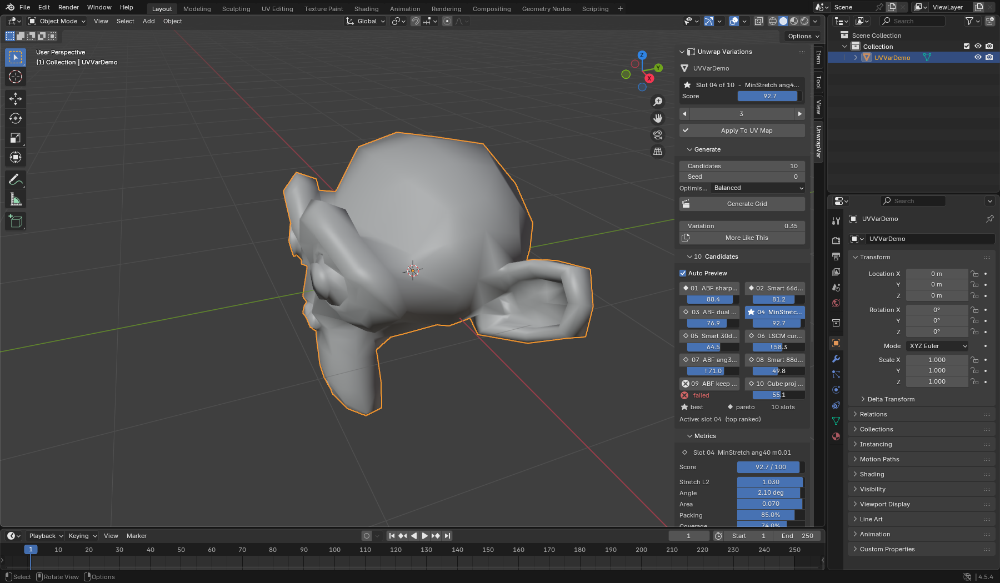
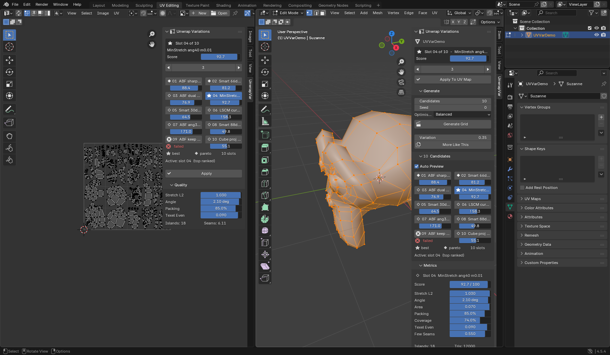
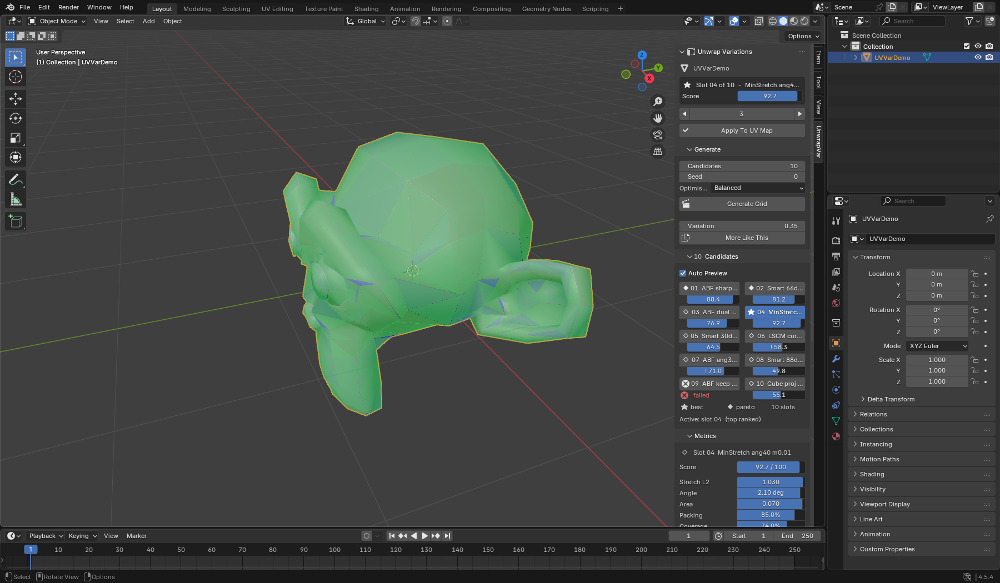
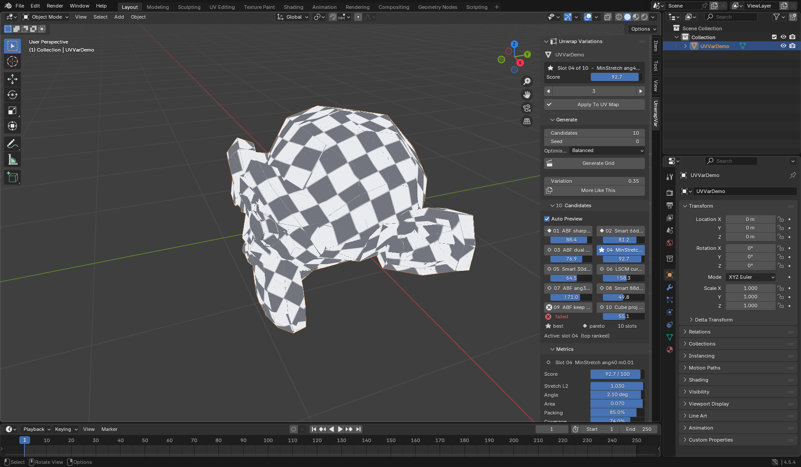

# Unwrap Variations

> Generate ten UV unwraps instead of one, score them all, and pick the winner.

A Blender add-on for anyone who has ever unwrapped a mesh, squinted at it,
changed the angle limit, unwrapped again, and lost track of which attempt was
better. Select a mesh, press **Generate Grid**, and get N candidate unwraps
produced by varying method, seam strategy, angle limits and margins. Every one
is measured -- stretch, angle and area distortion, island count, seam length,
packing efficiency, overlaps, flipped faces -- and ranked automatically. Click a
slot to preview it instantly. Press **More Like This** to breed ten variations
around the one you liked.

Nothing is written to your mesh until you press **Apply**.



[](https://www.gnu.org/licenses/gpl-3.0)
[](https://www.blender.org/download/)

---

## Why this exists

Unwrapping is a search problem that Blender makes you run in your head. The
solver is deterministic, but the *inputs* -- where to cut, which method, what
angle limit, how much margin -- are a large space, and the only way to compare
two points in it is to unwrap twice and look at a checker texture. So most
people try one or two and move on.

This add-on runs the search for you and, more importantly, **measures** the
results instead of asking you to eyeball them. That measurement is the part
that catches the failures you would otherwise ship: overlapping islands that
corrupt a normal-map bake, mirrored faces, one island stretched forty times
more than its neighbours.

It does not contain a new unwrapping algorithm. The solvers are Blender's own.
The contribution is search, measurement and ranking -- see
[what is and is not claimed](docs/BENCHMARKS.md#1-what-is-actually-being-claimed).

## Install

**Blender 4.2 and newer (extension).** Download or build
`unwrap_variations-<version>.zip`, then either drag it into a Blender window,
or use **Edit > Preferences > Add-ons > dropdown > Install from Disk**, and
enable **Unwrap Variations**.

**Blender before 4.2 (legacy add-on).** Use the `-legacy` archive instead --
its contents are wrapped in a top-level `unwrap_variations/` folder, which is
what the old installer expects. Install it through **Edit > Preferences >
Add-ons > Install**.

To build both archives from a source checkout:

```bash
python tools/build_extension.py
```

That writes two files into `dist/`:

```
dist/unwrap_variations-0.1.0.zip          <- Blender 4.2+ extension
dist/unwrap_variations-0.1.0-legacy.zip   <- pre-4.2 add-on
```

If a Blender executable is found on `PATH`, in `$BLENDER`, or in a standard
install location, the script uses Blender's own builder and validates the
result. Pass `--python-only` to build without Blender, or `--blender <path>` to
point at a specific one.

There is nothing to `pip install`. Blender already ships the only dependency
(numpy), and `pyproject.toml` exists purely so that ruff and pytest have
somewhere to read their configuration from.

## Quick start

1. Select a **mesh** object in the 3D Viewport.
2. Press <kbd>N</kbd> to open the sidebar and pick the **UnwrapVar** tab.
3. Set **Candidates** (default 10) and **Optimise For** (default *Balanced*),
   then press **Generate Grid**.
   Generation runs as a cancellable background job -- one candidate per tick,
   with a progress bar. Press <kbd>Esc</kbd> to stop it early and keep whatever
   finished.
4. Click any slot in the **Candidates** grid to preview it. The preview is a
   single memory copy into one scratch UV map called `UVVar_Preview`, so it is
   instant even on dense meshes. <kbd>Alt</kbd>+<kbd>[</kbd> and
   <kbd>Alt</kbd>+<kbd>]</kbd> step through slots without leaving the viewport.
5. Read the **Metrics** panel for the selected slot. Every bar is oriented so
   that **a full bar is good**, whether the underlying number is one you want
   high or low.
6. Found one you like? Press **More Like This** to generate a fresh grid of
   mutations around it. Turn **Variation** down for near-siblings, up for wilder
   jumps.
7. Press **Apply To UV Map** when you are happy. You choose whether to create a
   new UV map (default, named `UVMap_Variation`) or overwrite an existing one.
   Your original UV maps are untouched until this moment.

Reading the grid:

| Icon | Meaning |
| --- | --- |
| Star | Top-ranked candidate under the current **Optimise For** preset |
| Filled diamond | On the Pareto front -- nothing beats it on distortion, seams *and* packing at once |
| Hollow diamond | Beaten on every axis by something else in the grid |
| Crossed circle | The backend refused this recipe; the message says why |
| `!` before a score | The layout has overlaps or flipped faces. Look before you use it |

## Seeing what you picked

The same panel lives in the UV Editor sidebar, so you can browse candidates
while looking at the actual islands:



Two viewport overlays help judge a candidate without leaving the 3D view.
**Stretch** shades each face by how much it is distorted:



**Checker** projects a generated checker pattern through the previewed UVs.
Squares that are not square are stretched; squares that change size across the
model mean uneven texel density:



There is also a **Show Texel Density** button that swaps in a real checker
material instead of a viewport overlay, for when you want it to survive a
render or a screenshot. Your original materials are saved and restored.

## What the numbers mean

Every candidate carries the same measurements. Here is what each one is, in
terms of what it does to your texture.

### Stretch L2 -- the headline number

The Sander et al. (SIGGRAPH 2001) L2 stretch norm. It measures how much the
unwrap has to squash or stretch the surface to lay it flat, averaged over the
whole mesh and weighted by area.

**It is always at least 1.0, and 1.0 means perfect.** That is worth
understanding, because a number that can only go one direction is easy to
misread. The metric is normalised so that a perfect unfolding -- one where every
triangle keeps its exact shape and size, like unrolling a cylinder -- scores
exactly 1.0. Any curved surface has to be distorted somewhere to flatten it,
and the way the average is constructed, stretching one triangle can never be
cancelled out by squashing another. So the number starts at 1.0 and goes up
from there. **A value below 1.0 is always a bug**, never a great unwrap.

In practice: 1.00-1.05 is good, 1.05-1.2 is workable, above 1.5 you will see
it. The measured examples in [BENCHMARKS.md](docs/BENCHMARKS.md) include a
genuine catastrophe at 30.6.

### Stretch Linf

The same normalisation applied to the *worst single triangle* instead of the
average. A layout can have a fine L2 and a terrible Linf: that is one small
region ruining an otherwise good unwrap, and it is exactly the kind of thing an
average hides.

### Angle

Average corner-angle error, in degrees, between the 3D mesh and the flattened
one. Zero means angles are preserved perfectly (a *conformal* map). High angle
distortion shows up as shearing -- checker squares turning into parallelograms.

### Area

How unevenly the UV area is distributed relative to the real surface area,
measured as a mean absolute base-2 logarithm. **1.0 means the average triangle
gets twice (or half) the texture space it should**; 2.0 means a factor of four.
Zero means relative areas are preserved exactly.

### Islands, Seam len, Few Seams

The number of separate UV pieces, the total length of the cuts in world units,
and a scale-free version of that length. Fewer, shorter seams means less
visible texture discontinuity and less cleanup work -- but seams are also what
*relieves* distortion, so this trades directly against stretch. That trade-off
is the whole reason for the scoring presets below.

The scale-free version divides seam length by the square root of total surface
area, so a model imported in centimetres compares fairly against the same model
in metres.

### Packing, Coverage

**Packing** is how much of the space your islands occupy is actually used, as
opposed to wasted gaps between them. **Coverage** is how much of the 0-1 UV
square is used at all. Both are texture memory: low numbers mean you are paying
for pixels that contain nothing. Real packers land in the 0.6-0.8 range, and
the score is tuned accordingly -- 70% is not treated as a disaster.

### Texel Even

How consistent the texture resolution is across the model. Zero means every
part of the mesh gets the same number of pixels per centimetre. High values mean
some areas will look sharp and others blurry with the same texture.

### Overlap area and flipped faces

These are not "a number that is a bit high". They are **defects**, and the UI
gives them their own red warning box:

- **Overlapping UVs** mean two parts of the model share the same texels. Bakes
  bleed, and painting one area silently paints another.
- **Flipped faces** are mirrored in UV space. Normal-map bakes come out
  inverted on those faces.

Both carry a hard penalty in the score: a layout with any overlap at all ranks
below an otherwise-equal clean one, regardless of how good everything else
looks. This matters in practice -- Blender's own `smart_project` leaves 42
overlapping triangle pairs on Suzanne at its defaults.

### Score

All of the above collapsed into one 0-100 number, higher better, using the
weights of the selected preset. It is `100 * exp(-penalty)`, which is bounded
and provably monotonic: improving any single metric can never lower the score.

**Optimise For** picks the weighting:

| Preset | Use it when |
| --- | --- |
| **Balanced** | You do not have a strong opinion yet. The default |
| **Low Distortion** | Hero and character assets, where distortion shows up in the normal map |
| **Few Seams** | Hard-surface work, where every visible cut costs you a fix-up |
| **Tight Packing** | Atlases and lightmaps, where texture memory is the scarce resource |
| **Game Ready** | Shipping assets: overlaps and flips punished hard, even texel density valued |

Changing the preset re-ranks the existing grid instantly. You do not have to
regenerate to see what a different priority would have chosen.

## Seam strategies

Every seam-driven solver (ABF, LSCM, minimum-stretch) is only as good as the
cut it is handed. Blender provides the solvers; deciding where to cut is what
this add-on varies.

| Strategy | What it cuts |
| --- | --- |
| `NONE` | Nothing. Unwrap the whole thing as one sheet -- the control case |
| `EXISTING` | Exactly the seams you already marked, and nothing else |
| `SHARP` | Your seams **plus** every edge sharper than the angle threshold |
| `ANGLE` | Sharp edges only, ignoring what you marked |
| `CURVATURE` | Discrete mean curvature over a threshold, normalised to be scale-invariant. Unlike a plain angle test it also responds to element size, so a finely tessellated smooth curve stays uncut while the same shape tessellated coarsely reads as faceted and gets seamed |
| `DUAL_GRAPH` | See below |
| `SMART` | Nothing -- `smart_project` finds its own charts internally |

Boundary edges and loose edges are never seams under any strategy (there is
nothing on the other side to cut). Non-manifold edges -- three or more faces
meeting -- are always cut by the geometric strategies, because such an edge
cannot sit inside a flat chart.

### DUAL_GRAPH, explained

This is the interesting one, and it is worth understanding because it behaves
differently from every "mark edges over N degrees" tool you have used.

Think of the mesh as a graph where **each face is a node**, and two nodes are
joined whenever their faces share an edge. That is the *face dual graph*. Now
weight each connection by how **flat** the join is -- two coplanar faces get a
high weight, a sharp crease gets a low one.

Then:

1. **Build a maximum spanning forest.** Walk the connections from flattest to
   sharpest, keeping each one unless its two faces are already connected
   through others. What you end up with is a skeleton that holds the mesh
   together using the *flattest possible* set of joins.
2. **Cut the complement.** Every connection that was *not* kept becomes a seam.
   Because the forest greedily took the flat joins, the leftovers are the
   creases. The cut lands on the sharp edges without ever testing an angle
   threshold.
3. **Prune the dangling ends.** Step 2 leaves long dead-end chains wandering
   across flat regions -- confetti that costs seam length and buys nothing. Any
   seam edge whose endpoint has only one seam attached, and which is not on an
   opening of the surface, gets stripped, repeatedly, until nothing more can go.

What survives is clean, closed-ish cuts. A flat grid loses its cut entirely (a
disk needs no seam). A tube collapses to the single line joining its two rims. A
torus collapses to the two loops that actually reduce its genus.

Two guards stop the pruning from doing harm. A dangling edge that follows a real
crease is kept, because a cut along a crease relieves distortion even when it
dead-ends -- that is what the **Curvature Threshold** knob controls for this
strategy (low protects more, high prunes harder), and it is why a cube keeps
its seven-edge cross net no matter how aggressive you set it. And if pruning
would empty a *closed* component entirely, its original cut is restored: a
closed surface with no cut has no valid flat parameterisation at all.

The practical consequence: **DUAL_GRAPH cannot leave a component that is
impossible to unwrap.** Threshold-based seam marking can, and does. On a
cylinder, selecting sharp edges at 30 degrees marks 64 seams -- all 64 of them
horizontal rim circles, none lengthwise. The caps come off and the side is left
as a closed tube, which cannot be flattened. Blender's unwrap reports success
and returns a layout with a stretch of 30.6 and 12 flipped triangles. See
[the full write-up](docs/BENCHMARKS.md#43-the-most-instructive-row-the-cylinder-that-cannot-be-unwrapped);
it is the single clearest argument for measuring your unwraps.

The strategy also uses the **Seed** to break ties between equally flat joins,
so on a symmetric mesh different seeds give you genuinely different but equally
valid cuts. On a cube every join ties, so each seed produces a different one of
the classic cube unfoldings.

## Does it actually help?

> **These figures are provisional (measured 2026-08-07).** The scoring weights
> are being retuned, and because all three columns share one scorer, a weight
> change moves every number. Do not quote them as settled.
> [docs/BENCHMARKS.md](docs/BENCHMARKS.md) is the one place any benchmark
> number lives.

Measured, not asserted. Best-of-10 against Blender's own single-pass
unwrappers, across seven primitives, with all three columns scored by the same
evaluator, each measured five times and reported as a median.

**Record: 3 wins, 3 ties, 1 loss.**

- **Best case:** cylinder, **+59.2** points over the best baseline -- the
  topology case described above.
- **Worst case:** icosphere, where best-of-10 **loses by 6.7 points** to a
  plain sharp-edge unwrap. A smooth closed mesh has no creases for the seam
  heuristics to grip, and the sharp-edge baseline degenerates into "cut almost
  nothing and let the solver relax", which happens to be a good answer there.
- **Two former wins are now ties.** An earlier single-run version of this
  benchmark claimed 5 wins. The sphere's +0.6 margin turned out to be smaller
  than that mesh's own run-to-run variation, and the cone's +0.8 is too small
  to see on a model. Both were demoted. 3/3/1 is the honest record.

The scores matched between Blender 4.5.4 and 5.1.2, so the ranking you see does
not appear to depend on which supported version you run. No timing figures are
published yet -- a performance bug is being fixed that would make anything
measured today unrepresentative.

Full table, methodology, the competitive context against xatlas, and
regeneration instructions: **[docs/BENCHMARKS.md](docs/BENCHMARKS.md)**.

**What is not claimed.** This does not beat xatlas or RizomUV on raw
distortion, and it is not trying to. On the same corpus with the same scorer,
xatlas 0.0.11 is genuinely better than Blender native on distortion (Suzanne L2
1.0077 against 1.0298). This add-on wraps Blender's solvers -- it cannot beat a
better solver by wrapping a different one. What it does is search, measure and
rank, which no single-pass unwrapper does at all.

## Blender does not unwrap the same way twice

This surprised us, it is measurable, and it is worth knowing whether or not you
use this add-on.

**Running the same Blender UV operator twice on the same mesh does not produce
the same UVs.** Measured on 4.5.4, five runs each against a freshly rebuilt,
identical 48x24 UV sphere:

| Operator | Distinct results in 5 runs | Magnitude |
| --- | --- | --- |
| `smart_project` | 5 of 5 | about **3%** -- a genuinely different chart packing each time |
| `unwrap` (angle-based) | 5 of 5 | 1e-6 level |
| `cube_project` | 5 of 5 | 1e-6 level |

`cube_project` is the telling one. It is a pure analytical projection with no
solver in it at all, and it still differs between runs -- which identifies the
small variation as float and threading noise rather than solver behaviour.
`smart_project`'s 3% is a different order of thing: threaded chart packing that
lands somewhere slightly different each time.

This is not a Blender defect and it is not something this add-on can fix. But
it does have two consequences.

**For you, using this add-on:** pressing **Generate Grid** twice with the same
seed gives you slightly different candidates and slightly different scores. The
seed is not broken. It reproduces the same *recipes* faithfully; what it cannot
do is make Blender's solvers return the same *result* from a recipe.

**For the argument this add-on makes:** if pressing Unwrap twice can hand you
two different layouts, then you do not actually know what you got until you
measure it. "Generate several and rank them" stops being a convenience and
starts being the only way to know which layout is on your mesh.

It also sets the standard for the benchmark: a single run is a sample, not a
measurement, so every published figure is a median of five with its spread
reported. Two results previously claimed as wins did not survive that.

## Requirements and compatibility

| | |
| --- | --- |
| **Verified on** | Blender **4.5.4 LTS** and **5.1.2**, on **Windows** |
| **Manifest minimum** | Blender 4.2.0 (first release with extension support) |
| **Dependencies** | None. numpy ships inside Blender |
| **Optional** | An external [xatlas](https://github.com/jpcy/xatlas) binary, as an extra backend |

Those two versions on Windows are what was actually tested, so that is what is
claimed. The add-on is pure Python with no compiled parts and nothing
platform-specific in it, and the manifest deliberately declares no platform
restriction -- but **macOS and Linux have not been verified**, and neither have
Blender 4.2, 4.3 or 4.4 despite the manifest permitting them. If you run it
somewhere else, a report either way is genuinely useful.

The optional xatlas backend is off unless you configure it. xatlas is not
shipped inside Blender, so it is reached either through an importable `xatlas`
Python module or through an external binary named by the `UVVAR_XATLAS_BIN`
environment variable or the add-on preference. The add-on tells you which path
it found, or exactly what to set if it found neither.

## Limitations and known issues

Listed because you will hit them, not because they are theoretical.

- **The icosphere case loses.** Best-of-10 is beaten by 6.7 points by a single
  sharp-edge unwrap on smooth closed meshes with no creases. There is no seam
  strategy aimed at that case yet. Raising the candidate count is a mitigation,
  not a fix.
- **Not every slot fills, and it correlates with the losses.** On closed meshes
  -- sphere, torus, icosphere -- a 10-candidate grid currently comes back with
  8 usable candidates; the rest are recipes the solver could not complete.
  Those are exactly the three meshes that tie or lose in the benchmark, which
  points at one root cause rather than two problems: not enough viable
  diversity on closed surfaces. Failed slots are shown with a reason rather
  than hidden.
- **The same seed does not give byte-identical results.** Blender's own UV
  operators are non-deterministic, so re-running Generate reshuffles the
  candidates slightly. See
  [above](#blender-does-not-unwrap-the-same-way-twice). The recipes are
  reproducible; the layouts they produce are not.
- **A mesh can hold at most 8 UV maps.** This is a Blender limit, not ours --
  `uv_layers.new()` returns nothing past eight and does not raise. It is why
  candidates are stored as raw arrays and shown through a single scratch layer.
  If you are already at eight maps, **Apply** will refuse and offer to reclaim
  the preview layer's slot rather than silently doing nothing.
- **`uv.unwrap` reports success even when it fails.** Blender's operator returns
  `FINISHED` and leaves the previous UVs in place when it cannot solve an
  island. The add-on detects unchanged and degenerate results and marks the
  candidate failed, but this is inference, not a reliable signal from Blender.
- **Overlap detection is the expensive metric.** It is on by default and it
  dominates generation time on dense meshes. **Advanced > Detect Overlaps**
  turns it off; the overlap warnings go with it.
- **Packing behaves differently across Blender versions.** `uv.pack_islands`
  returns `CANCELLED` in 4.5 when running headless but `FINISHED` in 5.1. This
  affects scripted and CI runs rather than interactive use, and everything that
  depends on packing tolerates the cancellation.
- **Candidates are stored in the .blend by default**, up to a 64 MB budget
  (adjustable, or switch it off entirely, in the add-on preferences). Past the
  budget only metadata is kept and you are told -- a big exploration can never
  silently bloat your file.
- **The store is invalidated by edits.** Change the mesh's loop count and the
  cached candidates no longer describe it; they are discarded and you are told.
  Generate again after editing geometry.
- **An `ANGLE` overlay mode exists in the code but is not reachable from the
  UI.** Only *Stretch* and *Checker* are exposed.
- **Version 0.1.0, alpha.** Interfaces in `docs/ARCHITECTURE.md` are contract;
  everything else may move.

## Contributing and internals

- **[docs/DEVELOPMENT.md](docs/DEVELOPMENT.md)** -- how to run the tests, link
  the source into Blender so you can live-edit it, build the archives, run the
  headless harness, and the debugging traps specific to this add-on.
- **[docs/ARCHITECTURE.md](docs/ARCHITECTURE.md)** -- the binding module
  contract, plus a table of empirically probed Blender API behaviour that is
  worth reading even if you never touch this code.
- **[docs/BENCHMARKS.md](docs/BENCHMARKS.md)** -- every performance and quality
  number the project claims, and how to reproduce it.

The short version: the core is deliberately free of `bpy`, so most of the logic
runs and is tested under plain CPython with no Blender at all.

```bash
python -m pip install pytest numpy ruff
python -m pytest tests/ -v
ruff check .
```

## License

**GPL-3.0-or-later.** See [LICENSE](LICENSE).

This is not a preference. A Blender add-on links against Blender's Python API
at runtime, and Blender is GPL, so any add-on distributed for it must be
GPL-compatible. Every derivative of this code carries the same obligation:
ship the source.

Copyright (C) 2026 Eric Rolph.
